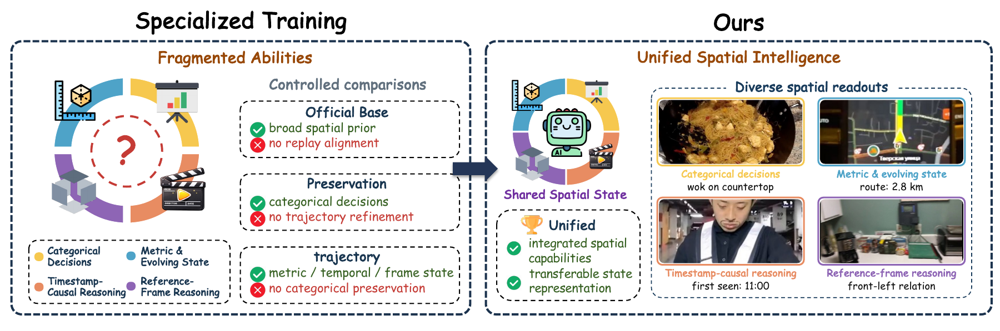
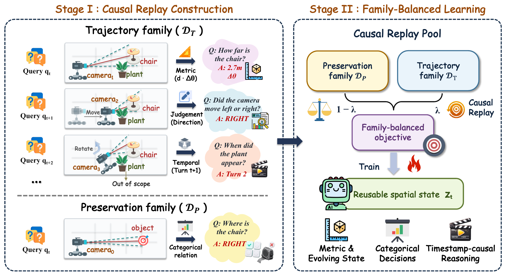

<div align="center">

# ChronoReplay
### One Answer Interface Is Not Enough for Streaming Spatial Intelligence

Yihao Hu*, Yitong Lin*, Pan Wang*, Zhihao Wen†, Hang Wang, Yiwen Zhao, Deyuan Liu, Yutong Li, Mingda WAN, Yuchen Mao, Tao Lin†

*Equal contribution. †Corresponding authors.*

[**Project Homepage**](https://yihaohu0118.github.io/ChronoReplay/) · [**Paper**](https://yihaohu0118.github.io/ChronoReplay/assets/ChronoReplay.pdf) · [**Code**](https://github.com/yihaohu0118/ChronoReplay)

[Overview](#overview) · [Quick start](#quick-start) · [Data](docs/data.md) · [Training](docs/training.md) · [Evaluation](docs/evaluation.md) · [Citation](#citation)

</div>

<p align="center"></p>

## Overview

ChronoReplay studies how heterogeneous spatial supervision can train one vision-language model to answer categorical, metric, and temporal questions from causal observation histories.

- **Causal replay:** keep trajectory turns in chronological order and retain each source-native target at its own observation boundary.
- **Family-balanced learning:** normalize complementary supervision families and combine them in one autoregressive training objective.
- **Controlled evaluation:** evaluate the same model under uniform observation access, then measure adaptive access separately.

The implementation fine-tunes Qwen3-VL-8B-Instruct with a frozen visual encoder, trainable language/merger parameters, and GPU-only ZeRO-3. This release contains implementation, configuration, and tests. Experiment score files and saved predictions are not bundled.

## Method



ChronoReplay retains source-native categorical, metric, and temporal targets at their causal observation boundaries. Chronological trajectory episodes and single-turn preservation examples contribute normalized losses to one family-balanced objective.

## Reported results

The following numbers are reported in the [paper](https://yihaohu0118.github.io/ChronoReplay/assets/ChronoReplay.pdf). All rows below use the same causal observation access; OVO-S uses Uniform-128. Higher scores are better.

| Model | OVO-S-Bench | OST-Bench | UCS-Bench |
|---|---:|---:|---:|
| Official Qwen3-VL-8B | 48.98 | 50.52 | 45.33 |
| **ChronoReplay** | **53.89** | **63.93** | **52.77** |
| Gain (points) | +4.91 | +13.41 | +7.44 |

Applying adaptive access to the same trained checkpoint separately raises OVO-S to **57.98**, using **80.50** frames on average instead of 128. This is an inference-time access effect, separate from the matched training comparison. The [project homepage](https://yihaohu0118.github.io/ChronoReplay/#results) includes supervision and observation-access comparisons.

## Codebase

| Component | Guide | Entry point |
|---|---|---|
| Environment | [Installation](docs/installation.md) | `python -m scripts.check_environment` |
| Data preparation | [Data and native record schema](docs/data.md) | `python -m scripts.prepare_data` |
| Frozen training membership | [Selection manifest](data_manifests/README.md) | `python -m scripts.materialize_frozen` |
| Training | [Training and controls](docs/training.md) | `python -m scripts.train` |
| OVO-S / OST / UCS | [Inference and scoring](docs/evaluation.md) | `python -m scripts.evaluate` |
| CPU example | [Quick start](#quick-start) | `python -m scripts.smoke_test` |

Low-level implementations remain in `data_pipeline/`, `synthesis/`, `spatial_witness/`, and `benchmark/`. Historical launchers are retained for existing artifacts; the public entry points above avoid machine-specific cache and deployment markers.

## Quick start

Clone the repository, then run the commands from its root.

```bash
git clone https://github.com/yihaohu0118/ChronoReplay.git
cd ChronoReplay
```

```bash
python3.11 -m venv .venv
source .venv/bin/activate
python -m pip install -r requirements.txt

# Generates synthetic images and native records, decodes the media,
# and builds a correctly weighted Parquet pool. No model is downloaded.
python -m scripts.smoke_test --output outputs/cpu-demo

# Inspect the exact training command without launching workers.
python -m scripts.train \
  --model models/Qwen3-VL-8B-Instruct \
  --data data/replay --output outputs/chronoreplay --gpus 8 --dry-run
```

Use a new output directory for each CPU example. The generated fixture validates software behavior; it is not a benchmark dataset.

For GPU execution, follow [installation](docs/installation.md), prepare [native data](docs/data.md), and use the complete [training](docs/training.md) and [evaluation](docs/evaluation.md) commands.

## Resources

| Resource | Access |
|---|---|
| Official initialization | [Qwen3-VL-8B-Instruct](https://huggingface.co/Qwen/Qwen3-VL-8B-Instruct), revision `0c351dd01ed87e9c1b53cbc748cba10e6187ff3b` |
| OST source episodes | [OST-Bench release](https://huggingface.co/datasets/rbler/OST-Bench) |
| Evaluation sources | [OVO-S-Bench](https://github.com/InternLM/OVO-S-Bench), [OST-Bench](https://github.com/InternRobotics/OST-Bench), [UCS-Bench](https://github.com/cocowy1/UCS-Bench) |
| Fine-tuned checkpoint | Supply a local checkpoint; fine-tuned weights are not included in this release. |
| Training membership | Frozen IDs, ordering, weights, and text hashes are included; converted records and media are obtained separately. See [data availability](docs/data.md#data-availability). |

## Tests

The full suite additionally needs CPU PyTorch (`torch>=2.6`) for evaluator imports. The GPU model requirements are not needed for the synthetic data example.

```bash
python -m pytest -q -p no:cacheprovider
```

The release checks cover data weighting, causal supervision masks, scene exclusions, complete shard merging, and public command construction. Validation details and remaining runtime checks are recorded in [release validation](docs/validation.md).

## Licensing and acknowledgements

Third-party code and source datasets retain their original terms; see [THIRD_PARTY.md](THIRD_PARTY.md). The authors have not yet selected a project-wide license. No project-wide open-source license is granted by this release.

The documentation structure follows the clear separation of overview, preparation, and evaluation in [OneStreamer](https://github.com/MCG-NJU/OneStreamer). Its model implementation and experimental claims are not part of ChronoReplay.

## Citation

```bibtex
@misc{hu2026chronoreplay,
  title={ChronoReplay: One Answer Interface Is Not Enough for Streaming Spatial Intelligence},
  author={Yihao Hu and Yitong Lin and Pan Wang and Zhihao Wen and Hang Wang and Yiwen Zhao and Deyuan Liu and Yutong Li and Mingda WAN and Yuchen Mao and Tao Lin},
  year={2026},
  url={https://yihaohu0118.github.io/ChronoReplay/}
}
```
